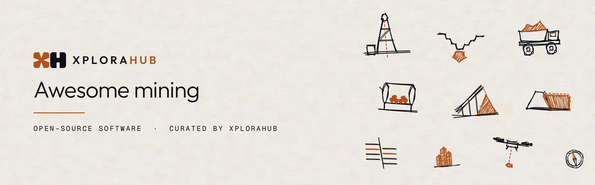

# Awesome Mining

> Open-source software for working mines, from pit to plant to closure.

A curated list of open-source software for mining (the physical kind): mine planning, drill and blast, haulage, ventilation, geotechnics, mine water, processing, tailings and closure. For finding the deposit in the first place, see the sister list, Awesome Mineral Exploration, under Related lists; tools used in both, such as QGIS, CloudCompare, OpenDroneMap and the geostatistics libraries, are listed there.

Every tool here is open source, has a licence and has been updated in the last 18 months, except those under No longer maintained, at the end. Icons show the main language; the licence follows each description. Curated by [XploraHub](https://xplorahub.com), open ground for exploration & mining technology.

## Contents

- [Mine planning and design](#mine-planning-and-design)
- [Block models and data formats](#block-models-and-data-formats)
- [Drill and blast](#drill-and-blast)
- [Haulage, fleet and operations](#haulage-fleet-and-operations)
- [Underground and ventilation](#underground-and-ventilation)
- [Geotechnics and rock mechanics](#geotechnics-and-rock-mechanics)
- [Mine water and hydrogeology](#mine-water-and-hydrogeology)
- [Geochemistry of mine water](#geochemistry-of-mine-water)
- [Mineral processing and metallurgy](#mineral-processing-and-metallurgy)
- [Tailings](#tailings)
- [Environment, closure and rehabilitation](#environment-closure-and-rehabilitation)
- [Related lists](#related-lists)
- [No longer maintained](#no-longer-maintained)

## Mine planning and design

- [MineFlow](https://github.com/MineFlowCSM/MineFlow) -  Library and command-line tool for ultimate pit limits using a pseudoflow solver adapted for mining, with variable slope precedence and support for sub-blocked models. MIT.
- [PitOpt](https://github.com/ghoziankarami/pitopt) -  Local application that turns a block model into nested pit shells, pushbacks, a mining sequence and preliminary bench and ramp geometry, with Excel, PDF and DXF exports. MIT.
- [Incline Design](https://github.com/Incline-Developers/Incline-Design) -  Cross-platform mine design CAD with pit and stockpile shell generation, triangulations and OMF 2 import, for Windows, Linux, macOS and the browser. MIT.
- [py-lerchs-grossmann](https://github.com/Mau-Aravena/py-lerchs-grossmann) -  Python package that applies the Lerchs-Grossmann algorithm to a block graph to find the optimal open pit. BSD-3-Clause.
- [Quaro](https://github.com/sbinabdullah/quaro) -  Browser-based open pit planning tool that builds an economic block model, runs ultimate pit and nested shell optimisation, and reports bench tonnages and grade-tonnage curves. Apache-2.0.
- [MMS 2.0](https://github.com/art-f-py/mms-2.0) -  Web tool for selecting underground mining methods using the UBC, Nicholas and related scoring methods on geotechnical, geometric and economic criteria. MIT.

## Block models and data formats

- [parq-blockmodel](https://github.com/elphick/parq-blockmodel) -  Python package for storing, indexing, reblocking and analysing large mining block models as Parquet files. MIT.
- [omfpandas](https://github.com/elphick/omfpandas) -  Converts Open Mining Format elements to DataFrames and Parquet files. MIT.

## Drill and blast

- [blast-physics-js](https://github.com/brentbuffham/blast-physics-js) -  JavaScript library of blast engineering models for vibration prediction, damage, detonation timing, flyrock and muckpile movement. MIT.
- [EXPLOCAL](https://github.com/EnriquePH/EXPLOCAL) -  Calculates the theoretical properties of commercial explosives, such as detonation velocity, energy and gas volume, from their composition. MIT.
- [NavDrill Quality](https://github.com/KennethKwabenaKenney/NavDrillQuality) -  Desktop tool that converts underground drill navigation logs into mine coordinates and reports as-drilled hole accuracy for drill and blast QA/QC. MIT.
- [SlopeForge](https://github.com/tinuvael/SlopeForge) -  Desktop application for tracking production and contour blasts, final-wall assessment and blast quality in open pits. GPL-3.0.

## Haulage, fleet and operations

- [OpenMines](https://github.com/370025263/openmines) -  Discrete-event simulator of open pit truck haulage for developing and benchmarking truck dispatch algorithms. MIT.
- [Mining-Gym](https://github.com/CBCodeHub/Mining-Gym) -  Configurable Gymnasium environment and discrete-event simulator for training and comparing reinforcement learning truck dispatch policies in open pits. MIT.
- [Mining-DRS](https://github.com/epicgamer17/mining-drs) -  Discrete rate simulation framework for mine material flow, from extraction faces and haulage fleets to stockpiles and plant. MIT.

## Underground and ventilation

- [VentPy](https://github.com/Miqueas7/VentPy) -  Python library with a C++ core for underground ventilation demand, Hardy Cross network solving and fan selection, with Peruvian and Chilean regulatory checks. MIT.
- [Mine Ventilation Network Simulator](https://github.com/Rodneymondela/ventilation-simulator) -  Web-based ventilation network editor and steady-state solver using Atkinson resistance and Hardy Cross, with fans, regulators and contaminant transport. MIT.
- [StopeForge](https://github.com/tinuvael/StopeForge) -  Desktop application for empirical open stope design with the Mathews-Potvin stability graph and a database of case histories. GPL-3.0.

## Geotechnics and rock mechanics

- [OGR Slip2D](https://github.com/samuelsl27/OGR-Slip2D) -  Two-dimensional slope stability by seven limit-equilibrium methods, with finite-element seepage and probabilistic analysis. AGPL-3.0.
- [xslope](https://github.com/njones61/xslope) -  Limit-equilibrium and finite-element slope stability, including jointed rock slopes, with finite-element seepage for embankments and dams. Apache-2.0.
- [PySlope](https://github.com/JesseBonanno/PySlope) -  Slope stability by Bishop's method of slices, with plotting and search for the critical slip surface. MIT.
- [DSEPy](https://github.com/adririquelme/DSEPy) -  Python successor to the MATLAB tool DSE, for extracting, viewing and classifying rock mass discontinuities from point clouds. GPL-3.0.
- [MPM-Geomechanics](https://github.com/fabricix/MPM-Geomechanics) -  Material point method code for large-deformation failure of soil and rock, with a mine slope failure example. MIT.
- [Yade](https://gitlab.com/yade-dev/trunk) -  Discrete element framework used for rock fracture, jointed rock masses and granular flow, scripted in Python. GPL-2.0.
- [geoeq](https://github.com/geoeq/geoeq) -  Geotechnical functions for SPT and CPT interpretation, liquefaction, bearing capacity and slope stability, useful for tailings and foundation checks. Apache-2.0.

## Mine water and hydrogeology

- [MODFLOW 6](https://github.com/MODFLOW-ORG/modflow6) -  USGS groundwater flow and transport model, the standard for pit dewatering and mine water inflow studies. CC0-1.0.
- [FloPy](https://github.com/modflowpy/flopy) -  Python package to build, run and post-process MODFLOW models. CC0-1.0.
- [PEST++](https://github.com/pestpp/pestpp) -  Parameter estimation and uncertainty analysis for groundwater models, used to calibrate dewatering and closure predictions. CC0-1.0.
- [pyEMU](https://github.com/pypest/pyemu) -  Python tools for PEST and PEST++ set-up, data-worth and uncertainty analysis. BSD-3-Clause.
- [GLM](https://github.com/AquaticEcoDynamics/GLM) -  General Lake Model, a one-dimensional lake model coupled to AED water quality and used to forecast pit lake stratification and chemistry. GPL-3.0.

## Geochemistry of mine water

- [PHREEQC](https://github.com/phreeqc-dev/phreeqc3) -  USGS aqueous geochemistry code for speciation, saturation indices, mixing and 1D reactive transport, the standard for acid mine drainage work. USGS user rights notice.
- [PhreeqPython](https://github.com/Vitens/phreeqpython) -  Object-oriented Python wrapper for PHREEQC for scripting speciation and treatment calculations. Apache-2.0.
- [MIN3P](https://github.com/kumayer/min3p) -  Reactive transport in variably saturated media, long used for sulfide oxidation in waste rock and tailings. MIT.
- [mf6rtm](https://github.com/p-ortega/mf6rtm) -  Couples MODFLOW 6 and PhreeqcRM for multicomponent reactive transport in groundwater. BSD-3-Clause.
- [Reaktoro](https://github.com/reaktoro/reaktoro) -  Chemical equilibrium and kinetics library with Python bindings, used for mine water and leach solution chemistry. LGPL-2.1.
- [CrunchFlow](https://github.com/CISteefel/CrunchTope) -  Multicomponent reactive transport code from Lawrence Berkeley National Laboratory, applied to mineral weathering and acid drainage. BSD-3-Clause-LBNL.

## Mineral processing and metallurgy

- [PrOMMiS](https://github.com/prommis/prommis) -  US DOE process models and optimisation for critical mineral recovery, including leaching, solvent extraction and precipitation. BSD-3-Clause-LBNL.
- [geometallurgy](https://github.com/elphick/geometallurgy) -  Mass and composition data handling, mass-balanced flowsheet simulation and plots for geometallurgy. MIT.
- [MUSEN](https://github.com/msolids/musen) -  GPU discrete element system for particle breakage and bonded agglomerates, used to study crushing and grinding. BSD-3-Clause.
- [MercuryDPM](https://bitbucket.org/mercurydpm/mercurydpm) -  Discrete particle simulation code for granular flows in chutes, hoppers and drums. BSD-3-Clause.
- [LIGGGHTS-INL](https://github.com/idaholab/LIGGGHTS-INL) -  Maintained fork of the LIGGGHTS discrete element code, the open DEM engine behind much mill liner, chute and conveyor transfer modelling. GPL-2.0.
- [OpenFOAM](https://github.com/OpenFOAM/OpenFOAM-dev) -  Finite-volume CFD toolbox used for hydrocyclone, flotation cell, slurry pipeline and ventilation flow models. GPL-3.0.

## Tailings

- [Anura3D](https://github.com/Anura3D/Anura3D_OpenSource) -  Material point method code for large deformation and soil-water interaction, used for embankment failure and runout. LGPL-3.0.

Also relevant here: xslope and OGR Slip2D (seepage and slope stability of embankments), geoeq (CPT liquefaction screening), MIN3P (tailings geochemistry), and the InSAR tools below.

## Environment, closure and rehabilitation

- [CAESAR-Lisflood](https://sourceforge.net/projects/caesar-lisflood/) -  Landscape evolution and erosion model used to test rehabilitated mine landforms over centuries to millennia; [HAIL-CAESAR](https://github.com/dvalters/HAIL-CAESAR) is its C++ port for Linux clusters. GPL-3.0.
- [MintPy](https://github.com/insarlab/MintPy) -  InSAR time-series analysis for ground deformation, applied to mine subsidence, pit walls and tailings dams. GPL-3.0.
- [LiCSBAS2](https://github.com/yumorishita/LiCSBAS2) -  InSAR time-series analysis from COMET LiCSAR products, a low-effort route to deformation over mine sites. GPL-3.0.

## Related lists

- [Awesome Mineral Exploration](https://github.com/XploraHub/awesome-mineral-exploration) - Open-source software for mineral exploration, including GIS, drones, point clouds and geostatistics.
- [Geoscience data portals](https://github.com/XploraHub/geoscience-data-portals) - Government geoscience data portals, with what each holds and its licence.
- [Awesome Mining Data](https://github.com/Arpeggeo/awesome-mining-data) - Open datasets for the mining industry.
- [Python Libraries for Engineers](https://github.com/joreilly86/Python-Libraries-for-Engineers) - Python libraries for civil, structural and geotechnical engineering.

## No longer maintained

Good tools that have had no updates for 18 months or more. They may not run on current versions of their dependencies, but the code and methods are still worth reading. Each is filed under the section it came from, and moves back there when it is updated again.

<b>Block models and data formats</b> (2)

- [omf-rust](https://github.com/gmggroup/omf-rust) -  Reference library for reading and writing Open Mining Format 2.0 files, with conversion from OMF 1. MIT. Last updated 2025.
- [omf-io](https://github.com/elphick/omf-io) -  Converts block models, rasters and other data into and out of Open Mining Format files. MIT. Last updated 2025.

## Contributing

To add a tool, open a pull request with one line in the right section. See [CONTRIBUTING.md](CONTRIBUTING.md) for the rules. Everyone taking part agrees to the [code of conduct](CODE_OF_CONDUCT.md).

The list is CC0. The icons, the code of conduct and the XploraHub name and banner have their own terms, set out in [NOTICE.md](NOTICE.md).
